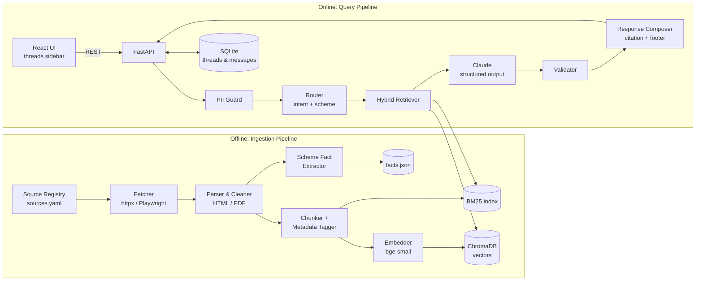
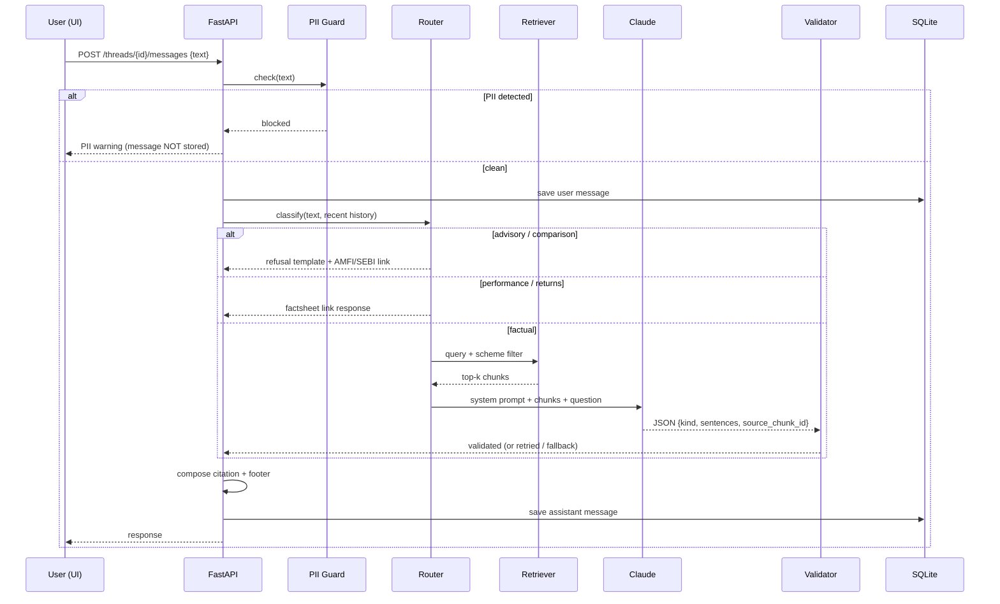

# Architecture: Mutual Fund FAQ Assistant (Facts-Only RAG)

> Requirements: [problemStatement.md](problemStatement.md). This document describes how the system is built to meet them.

## 1. Goals and Design Principles

| Principle | What it means in this design |
|---|---|
| **Accuracy over intelligence** | The LLM only rephrases retrieved text. It never answers from its own knowledge. If retrieval finds nothing relevant, the assistant says so. |
| **Rules enforced in code, not only in the prompt** | The 3-sentence limit, the single citation, the footer, PII blocking and refusals are checked or produced by deterministic code. The prompt alone is never trusted to enforce them. |
| **Exactly one source per answer** | The model picks *one* retrieved chunk by ID. The backend turns that ID into the URL, so the model can never invent a link. |
| **Privacy by default** | PII is detected *before* anything is stored, logged, embedded or sent to the LLM. |
| **Lightweight** | One Python service, a local vector store, a SQLite database, and a small web UI. No external infrastructure is required. |

## 2. Key Design Decisions

These resolve the open questions in [problemStatement.md §8](problemStatement.md#8-open-questions).

| # | Decision | Rationale |
|---|---|---|
| D1 | **Two source tiers.** The five Groww scheme pages are ingested as specified (Tier B). Official HDFC AMC documents (SID, KIM, monthly factsheet), AMFI and SEBI pages are ingested as Tier A. When both tiers support an answer, the citation **prefers Tier A**. | Keeps the corpus the brief specifies, while following the "official sources" constraint wherever possible. |
| D2 | **ELSS lock-in is answered from AMFI/SEBI** as a general fact (none of the five schemes is ELSS). | No need to add a scheme outside the given list. |
| D3 | **"Last updated" = the date the cited source was fetched** (`fetched_at`). If the document has its own printed date (e.g. a factsheet "as on" date), that date is stored too, and the footer uses it when present. | The footer stays honest about how fresh the cited fact is. |
| D4 | **Python + FastAPI backend, React (Vite) frontend.** | Python has the best RAG tooling. React makes the multi-thread sidebar simple. |
| D5 | **Claude Opus 5.5 (`claude-opus-5-5`)** for generation, with structured JSON output. | Strong instruction-following for strict format and refusal rules. Structured output makes responses machine-checkable. |
| D6 | **Local embeddings** (`BAAI/bge-small-en-v1.5` via `sentence-transformers`) + **ChromaDB** (persistent, on disk). | No API cost for embeddings, runs offline, and is fast enough for a corpus of a few hundred chunks. |
| D7 | **Hybrid retrieval** (BM25 + vector, fused with Reciprocal Rank Fusion) **with a scheme metadata filter**. | Fund questions contain exact terms ("exit load", "TER", "benchmark") that keyword search finds reliably. Filtering by scheme stops the assistant mixing facts from different funds. |

## 3. System Overview



## 4. Source Corpus

### 4.1 Source Registry (`data/sources.yaml`)

Every source is listed in one config file. The ingestion pipeline uses only these URLs; it never crawls beyond them.

```yaml
- id: groww-hdfc-mid-cap
  url: https://groww.in/mutual-funds/hdfc-mid-cap-fund-direct-growth
  tier: B
  source_type: groww_scheme_page
  scheme: hdfc-mid-cap
- id: groww-hdfc-small-cap
  url: https://groww.in/mutual-funds/hdfc-small-cap-fund-direct-growth
  tier: B
  source_type: groww_scheme_page
  scheme: hdfc-small-cap
- id: groww-hdfc-large-cap
  url: https://groww.in/mutual-funds/hdfc-large-cap-fund-direct-growth
  tier: B
  source_type: groww_scheme_page
  scheme: hdfc-large-cap
- id: groww-hdfc-silver-etf-fof
  url: https://groww.in/mutual-funds/hdfc-silver-etf-fof-direct-growth
  tier: B
  source_type: groww_scheme_page
  scheme: hdfc-silver-etf-fof
- id: groww-hdfc-multi-cap
  url: https://groww.in/mutual-funds/hdfc-multi-cap-fund-direct-growth
  tier: B
  source_type: groww_scheme_page
  scheme: hdfc-multi-cap
# Tier A (official) — fill in exact URLs at build time:
# - HDFC MF scheme pages, SID / KIM PDFs, latest monthly factsheet (hdfcfund.com)
# - HDFC MF "download account statement / capital gains statement" help page
# - AMFI investor-education pages (ELSS, riskometer, expense ratio)
# - SEBI investor pages (riskometer circular, investor education)
```

### 4.2 Scheme Registry (`data/schemes.yaml`)

This file maps how users refer to a fund to its canonical ID, so the router can tag each query with a scheme.

```yaml
hdfc-mid-cap:        { name: "HDFC Mid Cap Fund", aliases: ["mid cap", "midcap", "mid-cap opportunities"] }
hdfc-small-cap:      { name: "HDFC Small Cap Fund", aliases: ["small cap", "smallcap"] }
hdfc-large-cap:      { name: "HDFC Large Cap Fund", aliases: ["large cap", "largecap", "top 100"] }
hdfc-silver-etf-fof: { name: "HDFC Silver ETF FoF", aliases: ["silver", "silver etf", "silver fof"] }
hdfc-multi-cap:      { name: "HDFC Multi Cap Fund", aliases: ["multi cap", "multicap"] }
```

## 5. Ingestion Pipeline (Offline)

Run with `python -m app.ingest` manually or on a schedule (e.g. weekly, and after each new monthly factsheet).

| Stage | Implementation | Notes |
|---|---|---|
| **Fetch** | `httpx` with a fixed User-Agent and rate limiting. Falls back to headless Playwright for JS-rendered pages (Groww pages may load data client-side). | Raw HTML/PDF is saved to `data/raw/<source_id>/<date>.<ext>` so it can be audited and reprocessed. |
| **Parse** | HTML: `BeautifulSoup` / `trafilatura` to remove navigation, ads and footers. PDF: `pypdf` (tables via `pdfplumber`). | Keep section headings, since they make good chunk boundaries. |
| **Normalise** | Unicode cleanup, collapse whitespace, normalise `%` and `₹` formats. | |
| **Chunk** | Split by heading first, then by ~350 tokens with ~50 tokens of overlap. Small key-value sections (e.g. "Expense ratio: 0.74%") stay as one chunk. | Each chunk has a stable `chunk_id = <source_id>#<n>`. |
| **Tag metadata** | `source_id, url, tier, source_type, scheme, section, fetched_at, doc_date, content_hash`. | Used for scheme filtering, citations and the footer. |
| **Embed & index** | `bge-small-en-v1.5` → ChromaDB collection `mf_chunks`. BM25 index built with `rank_bm25` and saved to disk. | Re-ingesting is idempotent: chunks whose `content_hash` is unchanged are skipped. |
| **Extract scheme facts** | For each scheme, pull key fields into `data/facts.json`: expense ratio, exit load, min SIP, min lump sum, benchmark, riskometer, fund manager(s), plus the source chunk for each. | Used as an extra retrieval source and in tests (§11). Optional in v1. |

**Change detection:** if a source's `content_hash` changes, the old chunks are replaced and `fetched_at` is updated. Old versions stay in `data/raw/` for audit.

## 6. Query Pipeline (Online)



### 6.1 PII Guard (`app/guards/pii.py`)

This runs **first**, before anything is stored or logged. It uses regex plus checksum checks:

| PII | Detection |
|---|---|
| PAN | `\b[A-Z]{5}[0-9]{4}[A-Z]\b` (case-insensitive) |
| Aadhaar | 12 digits (spaces/hyphens allowed), validated with the Verhoeff checksum to cut false positives |
| Phone | Indian mobile `(\+91[\s-]?)?[6-9]\d{9}` |
| Email | Standard email regex |
| OTP | 4–8 digit number near words like `otp`, `code`, `pin`, `verification` |
| Account / folio no. | 9–18 digit number near words like `account`, `a/c`, `folio` |

If a match is found, the message is **not saved, not embedded and not sent to the LLM**. The user sees: *"For your security, please don't share personal details like PAN, Aadhaar, account numbers, OTPs, email or phone numbers. I can only answer general factual questions about mutual fund schemes."* Application logs record only `pii_blocked=true` and the PII type, never the value.

### 6.2 Router (`app/router.py`)

The router decides the intent and the scheme. It runs rules first, then an LLM fallback:

1. **Rule-based advisory detection:** phrases like *should I, is it good, better, best, recommend, worth, which fund, compare, vs, safe to invest, will it go up* → `advisory`.
2. **Performance detection:** *returns, CAGR, performance, NAV history, how much will I earn, 1Y/3Y/5Y* → `performance`.
3. **Scheme resolution:** alias matching against `schemes.yaml`. If the question has no scheme (e.g. "what about its exit load?"), take it from the **thread's last resolved scheme**.
4. **Follow-up rewriting:** if the question depends on earlier turns, a lightweight rewrite builds a standalone query from the last 3 turns (e.g. "and the benchmark?" → "What is the benchmark of HDFC Mid Cap Fund?").
5. Anything else → `factual`. The LLM can still mark it `refusal` or `not_found` (§6.4).

| Intent | Handling |
|---|---|
| `advisory` | Template refusal (§7). No retrieval, no LLM call. |
| `performance` | Template: *"I can't share or compare returns. You can see the official performance figures in the scheme's latest factsheet."* + factsheet URL for that scheme from the registry (or the AMC factsheet index if no scheme is named). |
| `greeting` / `help` | Welcome text + example questions. |
| `out_of_scope` | Polite note that only the listed HDFC schemes and general MF processes are covered. |
| `factual` | Retrieval + generation. |

### 6.3 Retriever (`app/retrieval.py`)

1. **Filter:** if a scheme was resolved, restrict to `scheme ∈ {resolved, null}` (null covers general AMFI/SEBI/process docs).
2. **Search:** BM25 top-20 and vector top-20, fused with **Reciprocal Rank Fusion** (k=60).
3. **Tier boost:** small score boost for Tier A chunks (D1).
4. **Return the top 5 chunks** with metadata.
5. **Relevance gate:** if the best fused score is below a set threshold, return `not_found` straight away (no LLM call). This avoids hallucinating from irrelevant chunks.

### 6.4 Generator (`app/llm.py`)

- **Model:** `claude-opus-5-5`, via the official `anthropic` Python SDK.
- **Effort:** `output_config.effort = "low"`. This is short-form Q&A, so low effort keeps latency and cost down. (Thinking can't be turned off on Opus 5.5; effort is the control to use.) Re-check with the eval set (§11) before changing it.
- **Structured output:** `output_config.format` with a JSON schema, so every reply can be parsed and validated:

```json
{
  "type": "object",
  "properties": {
    "kind": { "type": "string", "enum": ["answer", "not_found", "refusal"] },
    "sentences": { "type": "array", "items": { "type": "string" }, "maxItems": 3 },
    "source_chunk_id": { "type": ["string", "null"] }
  },
  "required": ["kind", "sentences", "source_chunk_id"],
  "additionalProperties": false
}
```

- **Why not the API's built-in citations feature?** It can't be combined with structured output. Its multiple inline citations also conflict with the "exactly one link" rule. Having the model pick one `source_chunk_id` keeps citations deterministic.
- **Prompt caching:** the system prompt (rules + examples) is fixed and comes first, marked with `cache_control`. The retrieved chunks and the question come after it, so the per-question parts never invalidate the cache.
- **Refusal safety:** server-side fallbacks enabled (`fallbacks: "default"` with beta `server-side-fallback-2026-07-01`). The code always checks `stop_reason == "refusal"` before reading content; if the model still refuses, the user gets the standard "not found" response.
- **Context passed:** only the top 5 chunks (formatted as `[chunk_id] (source, date) text`) and the standalone question. No raw chat history beyond the rewritten query, which keeps answers grounded.

**System prompt (outline):**
1. You are a facts-only mutual fund FAQ assistant. Use ONLY the provided context.
2. Never give advice, opinions, predictions, recommendations, comparisons or return calculations. If asked, set `kind = "refusal"`.
3. If the context doesn't contain the answer, set `kind = "not_found"`.
4. At most 3 short sentences. Quote numbers exactly as they appear in the context, with their "as on" date if one is given.
5. Set `source_chunk_id` to the single chunk that best supports the whole answer.
6. Don't include URLs or footers; the system adds them.

### 6.5 Validator (`app/validate.py`)

Checks run on every LLM reply:

| Check | On failure |
|---|---|
| JSON parses and matches the schema | Retry once, then use the `not_found` fallback |
| `len(sentences) ≤ 3` after sentence splitting (each array item counts as at least one sentence) | Truncate to the first 3 sentences |
| `source_chunk_id` is one of the retrieved chunk IDs | Retry once, then use the `not_found` fallback |
| No URLs in the text | Remove them |
| No advisory language (*recommend, should invest, better than, outperform*) | Replace with the refusal template |
| Numbers in the answer appear in the cited chunk (simple grounding check) | Retry once, then `not_found` |

### 6.6 Response Composer (`app/compose.py`)

The response is built by code. The model never writes the link or the footer.

```
<sentence 1> <sentence 2> <sentence 3>

Source: <url of source_chunk_id>
Last updated from sources: <doc_date or fetched_at, formatted "DD MMM YYYY">
```

The same format is used for refusals (educational link) and for `not_found` (the most relevant official link, e.g. the scheme's AMC page), so **every** response has exactly one link and the footer.

## 7. Refusal Handling

Refusals use fixed templates. Advisory questions are caught by the router, so no LLM output decides a refusal.

| Trigger | Template (example) | Link |
|---|---|---|
| "Should I invest…", "Is this fund good…" | "I can only share factual information about mutual fund schemes and can't advise on whether to invest. For guidance on choosing funds, please see the investor education resources below or consult a SEBI-registered investment adviser." | AMFI investor-education page |
| "Which is better…", "X vs Y" | "I can't compare or rank funds, since that would be investment advice. I can tell you individual facts, such as each fund's expense ratio, exit load or benchmark." | AMFI investor-education page |
| Predictions ("Will NAV rise?") | "I can't predict fund performance. I only provide verified facts from official sources." | SEBI investor-education page |

Link URLs live in `data/refusal_links.yaml` and are checked by a test (§11) so they never point at a dead page.

## 8. Multi-Thread Conversation Support

### 8.1 Data Model (SQLite, `data/app.db`)

```sql
CREATE TABLE threads (
  id          TEXT PRIMARY KEY,          -- UUID v4
  title       TEXT NOT NULL,             -- first question, truncated
  last_scheme TEXT,                      -- for follow-up resolution
  created_at  TEXT NOT NULL,
  updated_at  TEXT NOT NULL
);

CREATE TABLE messages (
  id              TEXT PRIMARY KEY,
  thread_id       TEXT NOT NULL REFERENCES threads(id) ON DELETE CASCADE,
  role            TEXT NOT NULL CHECK (role IN ('user','assistant')),
  content         TEXT NOT NULL,
  kind            TEXT,                  -- answer | refusal | not_found | performance | pii_blocked
  source_url      TEXT,
  source_date     TEXT,
  created_at      TEXT NOT NULL
);
CREATE INDEX idx_messages_thread ON messages(thread_id, created_at);
```

- **Isolation:** every request carries a `thread_id`. Retrieval, follow-up resolution and history are scoped to that thread only.
- **Concurrency:** FastAPI async handlers; SQLite in WAL mode allows many readers and one writer, which is enough at this scale. The retriever and embedder are loaded once per process and are read-only, so they're safe to share. Writes per thread are serialised with a per-thread `asyncio.Lock` so message order stays correct.
- **No user accounts / no PII:** threads are anonymous. The browser keeps its thread IDs in `localStorage`.
- **Scaling path:** swap SQLite for Postgres and run several Uvicorn workers. No other code changes are needed, because the service keeps no in-memory state between requests.

### 8.2 REST API

| Method | Path | Purpose |
|---|---|---|
| `POST` | `/api/threads` | Create a thread → `{id, title, created_at}` |
| `GET` | `/api/threads?ids=…` | List threads (by IDs the client holds) |
| `GET` | `/api/threads/{id}/messages` | Get a thread's history |
| `POST` | `/api/threads/{id}/messages` | Send a question → assistant response |
| `DELETE` | `/api/threads/{id}` | Delete a thread and its messages |
| `GET` | `/api/meta` | Welcome text, example questions, disclaimer, corpus last-updated date |
| `GET` | `/api/health` | Liveness + index loaded + corpus date |

Response body for `POST /messages`:

```json
{
  "message_id": "…",
  "kind": "answer",
  "text": "The expense ratio of HDFC Mid Cap Fund – Direct Growth is 0.74% as on 31 Oct 2026.",
  "source_url": "https://…",
  "last_updated": "2026-11-01"
}
```

## 9. User Interface

React + Vite single-page app, served as static files by FastAPI in production.

```
┌───────────────┬──────────────────────────────────────────────┐
│ + New chat    │  ⚠ Facts-only. No investment advice.          │
│               ├──────────────────────────────────────────────┤
│ ▸ Mid cap ER  │  👋 Hi! I answer factual questions about     │
│ ▸ ELSS lock-in│  selected HDFC mutual fund schemes using     │
│ ▸ Statements  │  official sources.                           │
│               │                                              │
│               │  Try asking:                                 │
│               │  [What is the expense ratio of HDFC Mid Cap?]│
│               │  [What is the exit load of HDFC Small Cap?]  │
│               │  [How do I download my capital gains stmt?]  │
│               │                                              │
│               ├──────────────────────────────────────────────┤
│               │  [ Ask a factual question…            ] [➤]  │
│               │  Please don't share PAN, Aadhaar, OTPs etc.  │
└───────────────┴──────────────────────────────────────────────┘
```

- **Disclaimer banner** is always visible (sticky header), not just on the welcome screen.
- **Example questions** are clickable chips that send the question.
- **Sidebar** lists threads; switching threads loads that thread's history. Several threads can wait on answers at the same time.
- **Assistant messages** show the source as a link and the "Last updated from sources" footer in muted text.
- **Input hint** reminds users not to enter personal details. The client runs the same PII regex check before sending, but the server is still the authority.

## 10. Project Structure

```
RAG Chatbot/
├── docs/
│   ├── ProblemStatement.txt
│   ├── problemStatement.md
│   └── architecture.md
├── backend/
│   ├── app/
│   │   ├── main.py            # FastAPI app, routes
│   │   ├── config.py          # settings (pydantic-settings, .env)
│   │   ├── db.py              # SQLite access, migrations
│   │   ├── guards/pii.py
│   │   ├── router.py          # intent + scheme resolution + rewrite
│   │   ├── retrieval.py       # BM25 + Chroma + RRF
│   │   ├── llm.py             # Anthropic client, prompt, schema
│   │   ├── validate.py
│   │   ├── compose.py
│   │   ├── templates.py       # refusal / performance / welcome texts
│   │   └── ingest/
│   │       ├── __main__.py    # python -m app.ingest
│   │       ├── fetch.py
│   │       ├── parse.py
│   │       ├── chunk.py
│   │       └── facts.py
│   ├── tests/
│   │   ├── test_pii.py
│   │   ├── test_router.py
│   │   ├── test_validate.py
│   │   ├── test_compose.py
│   │   └── eval/
│   │       ├── golden.jsonl   # question → expected fact / kind / source
│   │       └── run_eval.py
│   ├── pyproject.toml
│   └── .env.example           # ANTHROPIC_API_KEY, paths, thresholds
├── frontend/
│   ├── src/ (App.tsx, components/Sidebar, ChatPane, Message, Disclaimer)
│   └── package.json
├── data/
│   ├── sources.yaml
│   ├── schemes.yaml
│   ├── refusal_links.yaml
│   ├── raw/                   # fetched snapshots (gitignored)
│   ├── chroma/                # vector store (gitignored)
│   ├── bm25.pkl               # (gitignored)
│   ├── facts.json
│   └── app.db                 # (gitignored)
└── README.md
```

## 11. Testing and Evaluation

| Layer | What is tested |
|---|---|
| **Unit** | PII regex (positive and negative cases, including Verhoeff-valid and invalid Aadhaar numbers); router intent rules; validator (sentence count, URL stripping, wrong chunk ID); composer output format. |
| **Integration** | End-to-end `POST /messages` with a mocked LLM: each `kind` produces exactly one link + footer; a PII message is not saved to the DB. |
| **Thread isolation** | Two threads asking follow-ups at the same time ("its exit load?") resolve to their own schemes. |
| **Link health** | Every URL in `sources.yaml` and `refusal_links.yaml` returns HTTP 200 (run in CI / before release). |
| **Golden eval** (`run_eval.py`) | ~60 questions: ~35 factual (each scheme × each fact type, plus process questions), ~15 advisory/comparison, ~5 performance, ~5 PII. Metrics below. |

| Metric | Target |
|---|---|
| Factual accuracy (key value matches `facts.json` / expected) | ≥ 90% |
| Citation validity (cited chunk actually contains the fact) | ≥ 95% |
| Advisory refusal recall | 100% |
| False refusals on factual questions | ≤ 5% |
| Format compliance (≤ 3 sentences, 1 link, footer) | 100% (enforced by code) |
| PII block recall on the test set | 100% |

## 12. Configuration

`.env` (never committed):

```
ANTHROPIC_API_KEY=...
LLM_MODEL=claude-opus-5-5
LLM_EFFORT=low
EMBED_MODEL=BAAI/bge-small-en-v1.5
RETRIEVAL_TOP_K=5
RELEVANCE_THRESHOLD=0.02      # fused-score gate, tune with eval
DATA_DIR=../data
```

## 13. Security and Compliance

- **PII:** blocked at the server edge (§6.1). Logs are structured JSON with no message text for blocked requests and no request bodies at debug level.
- **Secrets:** API key only in `.env` / environment; `.env` is in `.gitignore`.
- **Prompt injection:** retrieved web content is wrapped as data in the prompt ("context documents"). The model's output is limited to the JSON schema, and links come only from the registry, so injected instructions can't add links or change the format.
- **Scraping etiquette:** fetch only the registered URLs, rate-limited, with ingestion run on a schedule rather than per query. Check each site's terms of use before scheduled scraping.
- **CORS:** restricted to the frontend's origin.

## 14. Build Plan

| Phase | Deliverable |
|---|---|
| 1. Corpus | `sources.yaml` complete with Tier A URLs; fetch + parse + chunk; inspect chunks manually. |
| 2. Retrieval | Chroma + BM25 + RRF; retrieval-only eval (is the right chunk in the top 5?). |
| 3. Generation | LLM call with structured output, validator, composer; CLI to ask questions. |
| 4. Guards & routing | PII guard, intent router, refusal/performance templates, follow-up rewriting. |
| 5. API & threads | FastAPI routes, SQLite schema, thread isolation tests. |
| 6. UI | React chat with sidebar, disclaimer, welcome message, example chips. |
| 7. Evaluation & docs | Golden eval at target; README (setup, AMC & schemes, architecture, limitations). |

## 15. Known Limitations

- **Data freshness:** facts are only as current as the last ingestion run. Expense ratios and factsheets change monthly, so the footer date must be read as "true as of this date".
- **Groww page structure:** Groww pages are JS-rendered and may change layout, which can break parsing. Tier A sources reduce this risk.
- **Limited scope:** five HDFC schemes plus general AMFI/SEBI process info. Other AMCs or schemes get an out-of-scope reply.
- **Rule-based routing** may miss unusually worded advisory questions. The LLM's `refusal` kind and the validator's advisory-word check are the second and third lines of defence.
- **PII detection is pattern-based** and can miss unusual formats or flag harmless numbers.
- **No personalised help:** the assistant can explain *how* to download statements but can't fetch them or access any account.
- **English only** in v1.
